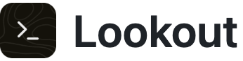

<picture>
  <source media="(prefers-color-scheme: dark)" srcset="docs/title-dark.png">
  
</picture>

Lookout is an extremely snappy, lightweight, open-source terminal for macOS built for Claude Code. Use Claude in the terminal with a VS Code-style file explorer, search, git and editor, and pick any element on your screen, in any app, to send straight to Claude.


It is built with [Tauri 2](https://tauri.app): a Rust backend for the shell sessions, files, search, git and the macOS Accessibility calls behind the picker, and a React frontend with [xterm.js](https://xtermjs.org) for the terminal and [CodeMirror](https://codemirror.net) for the editor. The app is about 18 MB, 7.5 MB as a download.

## Why Lookout

- **Built for Claude Code.** Open a Claude session in a tab with keys already set up for its prompt, and see at a glance which tabs are running Claude.
- **A picker for the whole screen.** Click any element in any app, a button in a browser, a row in another program, anything on screen, and send it to Claude with a screenshot and the details, so you never have to describe what you mean.
- **A full workspace.** A VS Code-style file explorer, project search, git with diffs, and a code editor, all in one window.
- **Fast and native.** A real macOS app built in Rust, about 18 MB, that opens instantly. No Electron and no bundled browser.
- **Free and open source.** MIT licensed, with no account, subscription or telemetry.

## Features

**Terminal**

- Tabs with your login shell, started in the open folder. ⌘T opens a terminal, ⇧⌘T (or the Claude button in the tab bar) opens a terminal that runs `claude`.
- New terminals start with "Last login: ..." as in Terminal, unless `~/.hushlogin` exists. Settings > Last login message turns it off.
- Tab titles follow the running program, and tabs running Claude Code get the Claude icon.
- GPU rendering, clickable links, find (⌘F) and clear (⌘K).
- Keys set up for Claude Code: Shift+Return is a new line in the prompt, ⌘← and ⌘→ go to the start and end of the line, ⌘⌫ deletes the line, ⌥← and ⌥→ move by word, ⌥⌫ deletes a word.
- For zsh, Lookout loads your own `.zshenv`, `.zprofile`, `.zshrc` and `.zlogin` and then adds what is missing: a colored prompt with the folder and git branch when you use the macOS default prompt, command highlighting with zsh-syntax-highlighting when you do not load it yourself, and colored `ls` output. It also marks where each command starts and ends, for notifications, and starts `claude` with two hooks that report when Claude is done (see Notifications). This only applies inside Lookout.

**Windows**

- ⌘N, or New Window in the Dock icon's menu, opens another window on the same folder. Each window has its own folder, tabs and panels, and closing a window ends its terminals.
- Drag a tab along the tab bar to reorder it, or drag it down out of the bar and let go to open it in a window of its own. A terminal keeps running and keeps what is on screen, and a file keeps unsaved changes. The tab's menu has Move to New Window too.
- ⇧⌘W closes the window.
- The window layout button in the top bar opens a panel with four layouts, as in the Rectangle app: left half, right half, center and fill the screen. Clicking left or right again steps the width through 1/2, 2/3 and 1/3, clicking center again makes the window larger, and clicking fill again puts the window back where it was. The tile for the current layout is highlighted. The layouts use the screen without the menu bar and the Dock.

**Element picker**

- Press ⌥⌘E anywhere, or click the picker icon in the sidebar, then point at something in any app and click. Up and Down select the parent or child element, Return picks, Esc or a right-click cancels.
- Lookout reads the element through macOS Accessibility: the app and window, the page address and title in browsers, the element's role, name, value and text, its DOM id and classes in Chromium and Electron apps, its position, the elements around it, and a screenshot of it.
- The report and screenshot are pasted into the Claude tab, followed by a space, so you can type your question right after. When no Claude tab is open, a new Claude session starts and gets the pick.
- Recent picks stay as chips under the terminal. Click one to send it again.

**Notifications**

- The bell in the top bar lists notifications from all windows as cards: Claude finishing (with the start of its reply), Claude asking for permission or input, commands that ran for 10 seconds or more finishing or failing, and messages programs send with the OSC 9 and OSC 777 escape codes. Click a card to go to its tab.
- When it comes from a tab you are not looking at, a card pops up under the bell for a few seconds. While another app is in front, Lookout posts a macOS notification instead. Settings > Mac notifications turns those off.
- Claude Code reports through its Stop and Notification hooks. Lookout's zsh starts `claude` with `--settings` pointing at its own hooks file, so your `~/.claude` settings and hooks stay as they are. Notifications are kept until Lookout quits.

**Files**

- An explorer like VS Code's, with file icons, git status colors, dimmed ignored files and live updates when files change on disk.
- New file, new folder, rename, move to Trash, reveal in Finder, copy path or relative path, open a terminal in a folder, and Mention in Claude, which types `@path` into the Claude tab.
- ⌘-click and ⇧-click select several files and folders, and ⌘A selects all shown. The menu then mentions, copies the paths of, or trashes all of them; ⌘⌫ moves the selection to the Trash.
- Drag files from Finder or another app onto a folder to copy them there, or onto the empty space to copy them to the project's top folder. A name that is taken gets a number, as in Finder. Drag files inside the tree to move them into another folder; open tabs follow. Files dropped on a terminal are typed in as paths.
- Quick open with ⌘P.

**Search**

- Search the folder with ripgrep's engine: match case, whole word, regular expressions, and files to include or exclude. `.gitignore` is respected. Click a result to open the file at that line.

**Source control**

- The top bar shows the number of changed files and the lines added and removed since the last commit, new files included. A click opens Source Control.
- Staged and unstaged changes, stage, unstage or discard one file or all, side-by-side diffs, commit with ⌘Return, push, pull, fetch, and switch or create branches.
- Uses the `git` installed on the Mac, with your config and credentials.

**Editor**

- Files open in tabs with syntax highlighting for most languages, find and replace, multiple cursors, bracket matching, folding and ⌘S to save.
- A single click opens a preview tab that the next single click replaces, as in VS Code. A double click or an edit keeps the tab.

**Settings**

- Light and dark mode in the top bar, next to the window layout button.
- The gear at the bottom of the sidebar has: editor theme and terminal theme (15 popular VS Code themes, One Dark Pro by default), code font for the terminal and the editor (SF Mono, Geist Mono, Menlo, Monaco and installed coding fonts such as JetBrains Mono or Fira Code), interface font (SF Pro or Geist), font size, line spacing, terminal cursor (underline, bar or block, blinking or not, and how fast it blinks), key repeat for ⌫, Delete, ← and → (fast by default, or the macOS setting), the Option key as Meta, copy on select, the last login message, scrollback length, the element picker on or off, word wrap in the editor, Mac notifications, and memes. Geist and Geist Mono ship with Lookout.
- Settings changed in one window apply to the other windows.
- The sidebar minimizes to a narrow strip with small icons.
- The cat button in the corner shows a random meme from Reddit through [meme-api.com](https://github.com/D3vd/Meme_Api), skipping posts marked NSFW. Settings > Memes turns it off.

## Keyboard shortcuts

| Keys | Action |
| --- | --- |
| ⌥⌘E | Pick an element on screen (works in any app) |
| ⌘T, ⇧⌘T | New terminal, new Claude session |
| ⌘N | New window |
| ⌘W, ⇧⌘W | Close tab, close window |
| ⌘1 to ⌘9, ⇧⌘[ and ⇧⌘], ⌃Tab | Switch tabs |
| ⌘O | Open folder |
| ⌘P | Quick open a file |
| ⌘B | Show or hide the sidebar panel |
| ⇧⌘E, ⇧⌘F, ⌃⇧G | Files, search, source control |
| ⌘F, ⌘K | Find in terminal, clear terminal |
| ⌘S | Save file |
| ⌘=, ⌘-, ⌘0 | Bigger, smaller, default font size |

## Install

With Homebrew:

```sh
brew install --cask lakialex/tap/lookout
```

Or download `Lookout_<version>_universal.dmg` from [Releases](../../releases), open it, and drag `Lookout` into the Applications folder. The build runs on Apple Silicon and Intel Macs and needs macOS 11 or later. A `.app.tar.gz` is attached too.

The app is not signed with an Apple Developer certificate or notarized, so the first time you open a download macOS says it cannot be verified. Either right-click the app and choose Open, then confirm once, or run:

```sh
xattr -dr com.apple.quarantine /Applications/Lookout.app
```

The Homebrew cask does this for you.

The picker needs two permissions, which Lookout asks for the first time you pick:

- Accessibility, to read elements in other apps. System Settings, Privacy & Security, Accessibility, switch Lookout on.
- Screen Recording, for the screenshot of the picked element. System Settings, Privacy & Security, Screen & System Audio Recording, switch Lookout on, then quit and reopen Lookout. Without it, picks are sent without a screenshot.

## Build from source

Requirements: [Rust](https://rustup.rs) (stable), Node.js 20 or later, and [pnpm](https://pnpm.io).

```sh
pnpm install
pnpm tauri dev           # run in development mode
scripts/install.sh       # build Lookout.app and install it in /Applications
```

`scripts/install.sh` signs the app with a requirement on its bundle id instead of the build, so macOS keeps the Accessibility permission across rebuilds. When Lookout runs through `pnpm tauri dev`, macOS gives the permission to the terminal that started it instead.

## Tests

```sh
cd src-tauri
cargo test
```

## Project layout

| Path | Contents |
| --- | --- |
| `src-tauri/src/picker.rs` | The element picker: event tap, Accessibility lookups, highlight window, report and screenshot |
| `src-tauri/src/pty.rs` | Shell sessions, and moving them between windows |
| `src-tauri/src/windows.rs` | Opening windows and which one is in front |
| `src-tauri/src/notices.rs` | Notifications and Claude's last reply |
| `src-tauri/src/shell.rs`, `src-tauri/shell/` | zsh startup files, zsh-syntax-highlighting and the Claude Code hooks |
| `src-tauri/src/files.rs`, `search.rs`, `git.rs` | Files and the file watcher, search, git |
| `src/App.tsx` | Layout, tabs, menus, settings, shortcuts |
| `src/components/` | Terminal, editor, diff view, panels, menus, dialogs |
| `src/lib/` | Editor and terminal themes, settings |
| `patches/` | A fix for xterm.js's WebGL renderer, applied by pnpm |
| `src-tauri/icons/` | App icon. `build-icon.sh` rebuilds the macOS 26 icon. |

## Data

- Recent folders: `~/Library/Application Support/com.laki.lookout/recent-folders.json`
- zsh startup files: `~/Library/Application Support/com.laki.lookout/shell/`
- Pick screenshots: `~/Library/Caches/com.laki.lookout/picks/`
- Picker log: `~/Library/Logs/com.laki.lookout/picker.log`
- Settings, themes and light or dark mode are stored by the app's web view.

## Third-party software

| Component | Used for | License |
| --- | --- | --- |
| [Tauri](https://tauri.app) | App framework | MIT or Apache-2.0 |
| [xterm.js](https://xtermjs.org) | Terminal | MIT |
| [CodeMirror](https://codemirror.net) | Editor and diff view | MIT |
| [React](https://react.dev) | Interface | MIT |
| [portable-pty](https://github.com/wezterm/wezterm/tree/main/pty) | Shell sessions | MIT |
| [ignore, grep-searcher, grep-regex](https://github.com/BurntSushi/ripgrep) | Search and the file list | MIT or Unlicense |
| [notify](https://github.com/notify-rs/notify) | Watching files | CC0-1.0 |
| [zsh-syntax-highlighting](https://github.com/zsh-users/zsh-syntax-highlighting) | Command highlighting in zsh | BSD-3-Clause |
| [Icons - Maintained](https://github.com/yusifaliyevpro/vscode-icons) | File icons in the explorer and tabs | MIT |
| [Hugeicons](https://hugeicons.com) | Icons | MIT |
| [Lucide](https://lucide.dev) | The title bar glyph | ISC |
| [Geist and Geist Mono](https://vercel.com/font) | Interface and code fonts | OFL-1.1 |
| [iTerm2-Color-Schemes](https://github.com/mbadolato/iTerm2-Color-Schemes) | Terminal theme colors | MIT |
| [tm-themes](https://github.com/shikijs/textmate-grammars-themes) | Editor theme colors | MIT |

[THIRD_PARTY_NOTICES.md](THIRD_PARTY_NOTICES.md) has more detail.

## FAQ

**Is Lookout free?** Yes. It is free and open source under the MIT license, with no account, subscription or telemetry.

**Do I need Claude Code?** Lookout is a normal terminal and works on its own, but it is built for [Claude Code](https://www.anthropic.com/claude-code) and has shortcuts and a picker made for it.

**What does the element picker do?** You press ⌥⌘E, click anything on screen in any app, and Lookout sends a description and a screenshot of it to your Claude session, so you can ask about it without explaining where it is.

**Does it work on Apple Silicon and Intel Macs?** The prebuilt download is for Apple Silicon (M1 and later), macOS 11 or later. On an Intel Mac you can build it from source.

**Why does it ask for Accessibility and Screen Recording?** Only for the picker: Accessibility lets it read the element you click in other apps, and Screen Recording lets it capture the screenshot. Nothing leaves your Mac.

## License

Lookout is released under the [MIT License](LICENSE).
